# Sparsity-Aware Winograd CNN Accelerators

2026 IDEC 창의회로설계 챌린지 디지털 부문 **SKKAF**팀의 지정주제·자유주제 설계와 검증 자료이다.
Winograd, 변환 영역의 zero-row 생략, integrated clock gating(ICG)을 결합하고,
MNIST 단일 코어에서 검증한 방법을 CIFAR-10 VGG의 SRAM 기반 16코어 구조로 확장하였다.

| | 지정주제 | 자유주제 |
|---|---|---|
| 응용 | MNIST 이미지 분류 | CIFAR-10 VGG 이미지 분류 |
| 구조 | Conv/FC 공유 단일 코어 | 출력 채널을 분담하는 16코어, activation multicast |
| 연산 자원 | 16-lane MAC | 코어당 16-lane MAC |
| 수치 형식 | W4A8, 변환 V INT11, 누산 INT18 | 변환 U/V INT8 저장, 스케일 복원 후 연산 |
| 저장 구조 | activation scratchpad와 소형 pipeline buffer | 코어당 12개 × 8KiB SRAM, 총 192개 macro |
| 최종 RTL | [verilog/](verilog/) | [free_topic_vgg/rtl/](free_topic_vgg/rtl/) |
| 결과보고서 | [지정주제 PDF](docs/IDEC_지정주제_결과보고서_제출용.pdf) | [자유주제 PDF](docs/IDEC_자유주제_결과보고서_제출용.pdf) |

포스터에서 생략한 회로는 아래 **[단일 코어 세부 회로](#single-core-circuits)**와
**[SRAM·멀티코어 세부 회로](#multi-core-circuits)**에 모았다.
회로도는 아래에 펼쳐 놓았으며, 각 그림 아래에 역할과 RTL 링크를 함께 정리했다.

| 타일·전달 | 연산·변환 | 후처리·저장·클록 | 멀티코어 |
|---|---|---|---|
| [Tile generator](#tile-generator) | [Input transform](#input-transform) | [Fused output unit](#fused-output) | [SRAM banks](#sram-banks) |
| [Elastic FIFO](#elastic-fifo) | [MAC array / PREG](#mac-array) | [Storage reuse](#storage-reuse) | [Sharding / multicast](#multicast-circuit) |
| [Conv/FC core reuse](#core-reuse) | [Output transform](#output-transform) | [ICG / standard cell](#icg-circuit) | [SRAM / compute path](#sram-compute) |

## 1. 공통 설계 방법

### 1.1 Winograd 원리: 겹치는 작은 커널 연산을 함께 계산

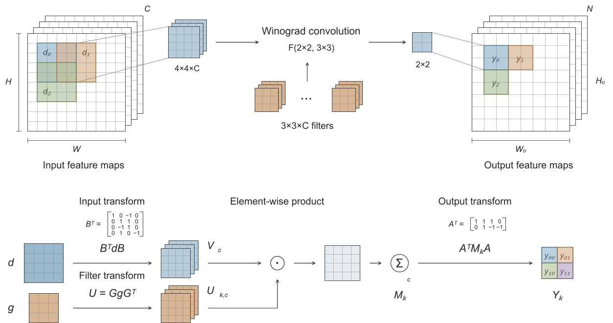

3×3 convolution은 입력의 3×3 영역과 가중치를 곱해 더하여 출력 하나를 만든다.
Stride 1에서 인접한 출력 네 개를 계산하면 입력 영역이 서로 겹친다.
**Winograd F(2×2, 3×3)는 이 네 출력을 하나의 작업으로 묶어, 4×4 입력 타일에서 2×2 출력을 계산한다.**

직접 합성곱은 출력마다 9번씩 총 `2 × 2 × 3 × 3 = 36`번 곱한다.
Winograd는 입력과 가중치를 각각 변환한 뒤, **변환된 4×4 배열의 같은 위치끼리 16번만 곱하고**
출력 변환으로 네 출력을 복원한다. 입력값을 단순히 재사용하는 데 그치지 않고,
덧셈·뺄셈으로 만든 조합을 곱하여 필요한 곱셈 자체를 줄이는 방식이다.

| 비교 항목 | Direct 3×3 convolution | Winograd F(2×2, 3×3) |
|---|---:|---:|
| 입력 영역 / 출력 영역 | 4×4 / 2×2 | 4×4 / 2×2 |
| 곱셈 횟수¹ | 36 | 16 |
| 곱셈 감소율 | — | **55.56% (2.25배 적은 곱셈)** |
| 추가 처리 | — | 입력·가중치·출력 변환 |

¹ 입력 채널 하나와 출력 채널 하나에 대한 타일 기준. 이 감소는 입력의 zero 비율과 무관하다.
변환과 데이터 공급 비용이 있으므로 전체 실행 시간이 곱셈 수와 같은 비율로 줄어드는 것은 아니다.

여러 입력 채널이 있으면 채널별 원소 곱을 **변환 영역에서 먼저 누산**하고,
누산이 끝난 뒤 출력 변환을 한 번 수행한다. 출력 채널마다 다른 U를 사용하면서 같은 V를 재사용한다.

```text
U = G g Gᵀ              변환 가중치
V = Bᵀ d B              변환 activation
M[k] = Σc (U[k,c] ⊙ V[c])  입력 채널 c 방향 누산
Y[k] = Aᵀ M[k] A          출력 채널 k의 2×2 결과
```

여기서 `⊙`는 행렬 곱이 아닌 **같은 위치의 원소끼리의 곱**이다.
입력·출력 변환은 덧셈과 뺄셈으로 구현하며, 변환 가중치 U는 준비하여 재사용한다.
본 설계의 16-lane MAC은 이 4×4 원소 곱과 채널 방향 누산을 수행한다.
이후 설명하는 sparsity 처리는 **남아 있는 16개 원소 중 결과에 기여하지 않는 zero row까지 생략**하는 추가 최적화이다.

변환 과정에서 검출한 zero row는 MAC에 투입하지 않고 유효 행만 처리하도록 순서를 제어한다.
ICG는 유효 작업이 없는 레지스터의 클록 활동을 억제한다. 생성된 결과에는 bias, ReLU,
pooling 및 requantization을 연속 적용하여 중간 데이터 이동을 줄인다.
두 주제는 이 최적화 방법을 공유하며, 저장 장치와 데이터 공급 구조는 모델의 규모에 맞춰 구성했다.

### 1.2 무엇을 검출하는가: 변환 영역의 zero row

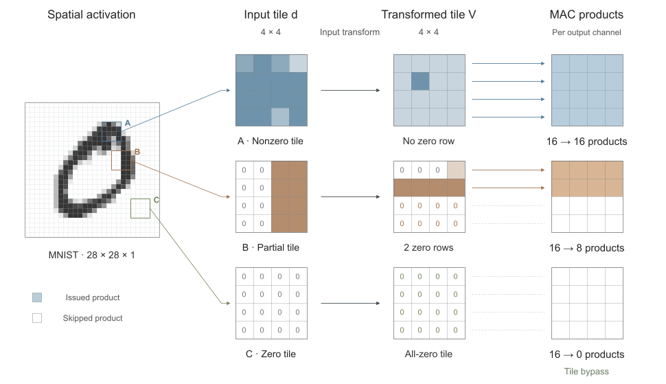

검출 단위는 원본 이미지의 개별 zero pixel이 아니라 **변환된 4×4 타일의 한 행, 즉 네 원소 전체가 0인 경우**이다.
입력값이 모두 0인 영역뿐 아니라, 서로 같은 비영 입력이 변환의 뺄셈에서 상쇄되는 경우도 검출한다.
예를 들어 입력 타일의 첫 번째 행과 세 번째 행이 같으면, 첫 변환의 `T[0,:] = d[0,:] − d[2,:]`는 0이 된다.
이 행은 가중치 값과 관계없이 곱셈·누산 결과에 기여하지 않는다.

### 1.3 어디서 검출하는가: 두 변환 단계 사이

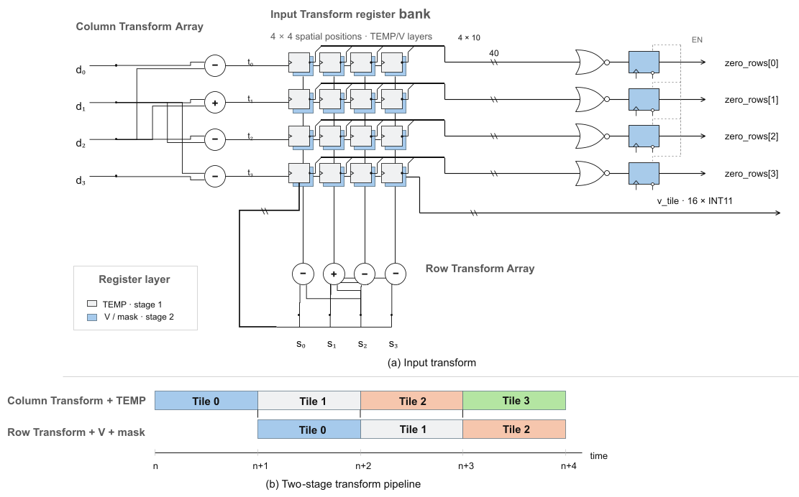

지정주제의 [입력 변환 RTL](verilog/winograd_input_transform.v)은 세로 방향 변환 T0와
가로 방향 변환 T1의 두 단계로 구성된다.

```text
4×4 입력 d → T0: T = Bᵀd → T 레지스터 → T1: V = TB → V 레지스터
                                       └→ 행별 NOR → zero_rows[3:0]
```

`temp_tile`에 저장된 한 행은 4 × 10 = 40비트이다. 각 행에 reduction NOR를 적용하여
모든 비트가 0이면 해당 `zero_rows` 비트를 1로 설정한다. mask는 T1의 결과 V와 같은 클록 경계에서
등록되며, 출력이 정지하면 데이터와 함께 유지된다. **검출 전용 파이프라인 단계를 추가하지 않는다.**

```verilog
zero_rows[row] <= ~|temp_tile[row*TILE_SIZE*TEMP_BITS +: TILE_SIZE*TEMP_BITS];
```

이 위치에서 검사할 수 있는 이유는 오른쪽 변환 행렬 B가 가역이기 때문이다.
현재 지정주제의 ACT/TEMP/V = 8/10/11비트에서는 변환 중 잘림 없이 다음 관계가 성립한다.

```text
T[r,:] = 0  ⇔  V[r,:] = T[r,:]B = 0
```

따라서 **최종 변환의 행 전체가 0인 경우는 중간 단계에서도 검출할 수 있다.**
T1에서 새로 생기는 개별 zero 원소는 있을 수 있지만, 행 전체가 0인 경우와는 다르다.
이 설명은 지정주제의 정확한 정수 변환 기준이며, 자유주제의 V8 재양자화에서 생기는 zero와 구분한다.

### 1.4 어떻게 사이클을 줄이는가: 행별 압축과 전체-zero 우회

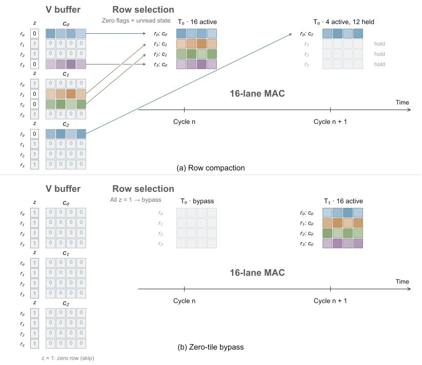

지정주제의 [V replay buffer](verilog/winograd_v_replay_buffer.v)는 같은 공간 위치의 입력 채널 타일들과
각 타일의 4비트 mask를 함께 저장한다. 출력 채널을 바꿔 재사용할 때도 mask를 유지한다.
네 행은 각각 독립적으로 다음 유효 입력 채널을 선택하고, 그 채널에 대응하는 가중치 행을 가져온다.
선택할 행이 없는 lane 그룹은 `row_enable`로 비활성화한다.

예를 들어 한 공간 위치에 **입력 채널 3개, 채널마다 4×4 타일**이 있고,
zero row를 제외한 각 행의 작업이 아래와 같다고 하자.

| 변환 행 | 남은 입력 채널 | 첫 MAC 투입 | 두 번째 MAC 투입 |
|---|---|---|---|
| 0 | 채널 0, 2 | 채널 0의 행 0 | 채널 2의 행 0 |
| 1 | 채널 1 | 채널 1의 행 1 | 비활성 |
| 2 | 채널 0, 1 | 채널 0의 행 2 | 채널 1의 행 2 |
| 3 | 채널 2 | 채널 2의 행 3 | 비활성 |

채널을 일괄 처리하면 3번 필요한 MAC 투입을 행별 압축으로 **2번**에 끝낸다.
각 행 내부의 입력 채널 누산 순서는 유지하며, 마지막 투입에서 네 행의 결과를 함께 완료한다.
이때 활성 MAC lane 슬롯도 `3 × 16 = 48`개에서 `(2 + 1 + 2 + 1) × 4 = 24`개로 줄어든다.

```text
행 r의 유효 입력 채널 수 = n[r]
일반 작업의 MAC 투입 횟수 = max(n[0], n[1], n[2], n[3])
활성 MAC lane 슬롯 수 = 4 × Σr n[r]
```

이 식은 **한 공간 타일·한 출력 채널의 MAC 투입 횟수**이며, 공급 대기와 파이프라인 지연을 포함한 전체 사이클 식은 아니다.
어느 한 행에 작업이 몰리면 MAC 투입량 감소와 사이클 감소가 같은 비율로 나타나지 않는다.

모든 입력 채널의 네 행이 0이면 [코어 제어 RTL](verilog/winograd_conv_core.v)은 MAC과 출력 변환을 우회한다.
이 작업은 순서 FIFO에 descriptor만 넣고, 앞선 일반 작업의 순서를 지킨 뒤 0인 convolution 결과를 후처리기로 전달한다.
**Bias·ReLU·pooling 등의 후처리는 그대로 수행하므로, 전체-zero 입력의 최종 출력이 반드시 0인 것은 아니다.**

이처럼 sparsity 제어는 실행할 작업 수를 줄이고, ICG는 남아 있는 유휴 구간의 클록 활동을 줄인다.
공급 대기가 실행 시간을 지배하면 연산을 생략해도 전체 사이클 절감은 제한되며,
자유주제의 공급 속도별 통제 실험에서는 이 차이를 별도로 측정했다.

## 2. 지정주제: 단일 코어 MNIST 가속기


3×3 convolution 두 계층과 FC를 하나의 연산기로 처리한다. W4A8 QAT와 정수 기준 모델로
수치 형식을 결정하고, activation의 소비 시점에 따라 scratchpad 주소를 재사용한다.
최종 구성은 sparsity-aware bypass와 ICG를 함께 적용한 **b1_g1**이다.

<a id="single-core-circuits"></a>

### 단일 코어 세부 회로

아래 그림은 같은 코어의 서로 다른 부분을 확대한 것이다. 전체 데이터 경로는
타일 생성 → 입력 변환 → V 재사용·행 선택 → MAC → 출력 변환 → 후처리 순서이며,
FC에서는 변환 경로를 우회하여 같은 MAC을 사용한다.

<a id="core-reuse"></a>

#### 1. 전체 파이프라인과 Conv1 → Conv2 → FC 자원 공유

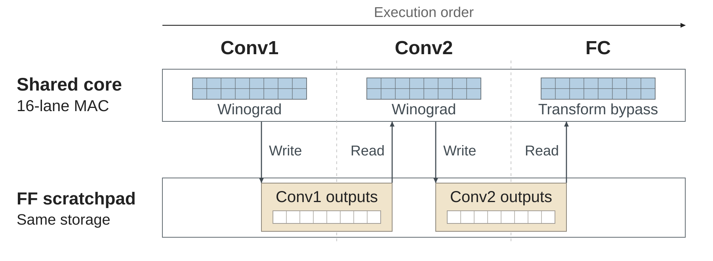

**Conv1·Conv2·FC를 별도 연산기로 복제하지 않고 하나의 16-lane MAC으로 순차 실행한다.**
Convolution에서는 4×4 변환 좌표를 병렬 처리하고, FC에서는 10개 클래스에 대응하는 lane을 사용한다.
Conv1의 후처리 결과는 scratchpad를 거쳐 Conv2에, Conv2의 결과는 같은 저장소를 거쳐 FC에 전달한다.
아래 시간 흐름 그림의 구간 폭은 실행 순서를 나타내며 측정 시간을 뜻하지 않는다.

RTL: [전체 스케줄·레이어 전환](verilog/winograd_cnn_accelerator.v),
[Conv/FC 공유 코어](verilog/winograd_conv_core.v),
[최종 클래스 선택](verilog/pipelined_argmax10.v).


<a id="tile-generator"></a>

#### 2. Sliding window: 순차 입력에서 4×4 타일 생성

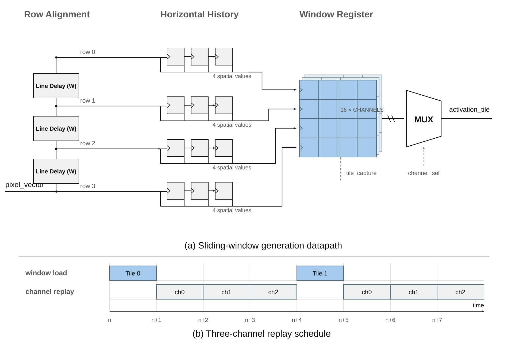

세 줄의 line delay가 이전 행을 보존하고, 각 행의 수평 이력이 현재 입력과 함께 4×4 윈도우를 만든다.
완성된 공간 윈도우를 잡아 둔 뒤 입력 채널별 타일을 순서대로 내보낸다.
전체 feature map에서 임의의 16개 위치를 동시에 읽는 대신, **입력 순서와 고정 지연을 이용해 타일을 조립한다.**
외부 pixel 인터페이스는 [chip wrapper](verilog/chip.v)에 유지하며, 내부 타일 경로와 구분한다.

RTL: [winograd_sliding_window_generator.v](verilog/winograd_sliding_window_generator.v).


<a id="elastic-fifo"></a>

#### 3. Elastic FIFO: 단계 사이의 정지와 재개

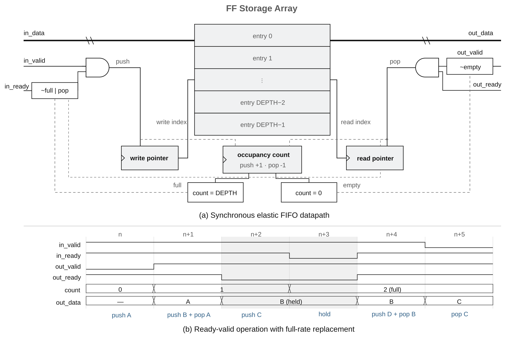

각 단계는 `valid/ready`가 함께 참일 때 데이터를 전달한다. 출력이 정지하면 FIFO가 데이터와 순서를 유지한다.
FIFO가 가득 찼어도 같은 사이클에 pop이 가능하면 새 데이터를 받을 수 있다.
최종 지정주제의 Tile FIFO와 V replay buffer 깊이는 각각 2, M FIFO 깊이는 1이다.
Line buffer가 공간 윈도우를 만드는 동안, 이 FIFO들은 **서로 다른 파이프라인 단계의 처리 시점을 맞춘다.**

RTL: [elastic_fifo.v](verilog/elastic_fifo.v), [M FIFO](verilog/winograd_m_fifo.v),
[V replay buffer](verilog/winograd_v_replay_buffer.v).


<a id="input-transform"></a>

#### 4. 입력 변환: 덧셈·뺄셈 파이프라인과 zero-row mask

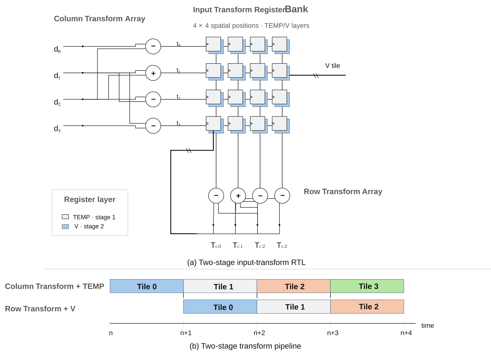

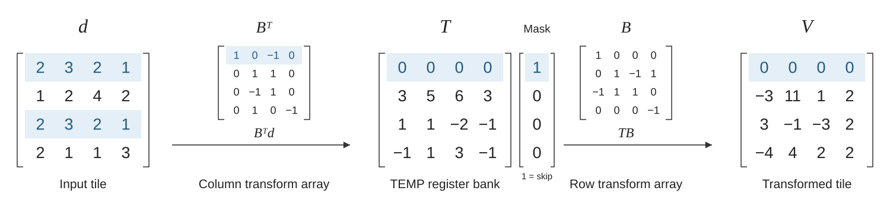

첫 단계는 각 열에 같은 1차원 변환을 적용하여 `T = Bᵀd`를 만들고, 둘째 단계는 각 행을 변환하여 `V = TB`를 만든다.
행렬 계수가 0·1·−1이므로 일반 행렬 곱셈기가 아닌 덧셈·뺄셈 회로로 구현한다.
중간 T 레지스터는 두 방향의 변환을 나누는 파이프라인 경계이면서,
**행 전체의 zero 여부를 검사하는 지점**이다.
검출 회로와 mask 전달은 [1.3절](#13-어디서-검출하는가-두-변환-단계-사이),
mask에 따른 MAC 작업 압축은 [1.4절](#14-어떻게-사이클을-줄이는가-행별-압축과-전체-zero-우회)에 설명했다.

RTL: [winograd_input_transform.v](verilog/winograd_input_transform.v).


<a id="mac-array"></a>

#### 5. MAC 내부: 곱셈 결과 등록, 채널 누산, 결과 전달

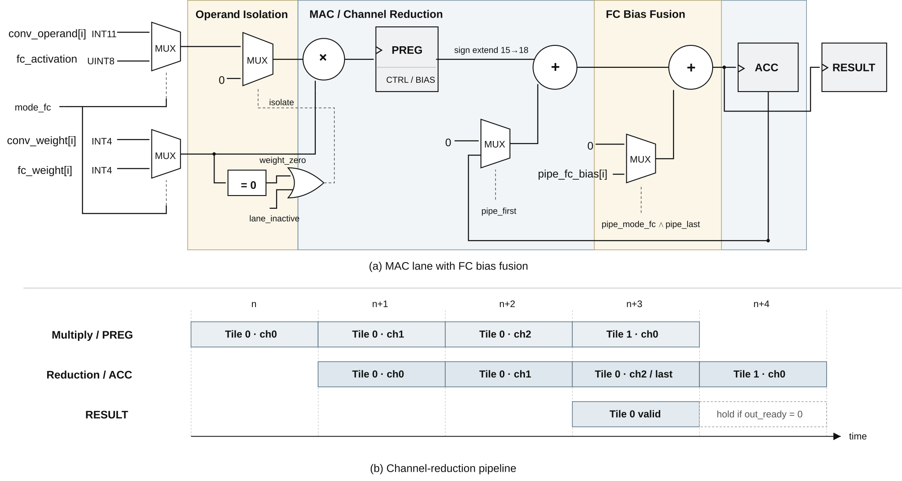

Conv의 signed INT11 변환값 또는 FC의 UINT8 activation을 선택하여 INT4 가중치와 곱한다.
**PREG는 곱셈 결과 레지스터**, ACC는 입력 채널·FC feature에 걸친 INT18 누산 레지스터,
RESULT는 완료된 작업을 다음 단계로 넘기는 레지스터이다.
첫 입력에서 누산을 초기화하고 마지막 입력에서 결과를 확정하며, 출력 정지 시 결과를 유지한다.
행별로 고른 activation과 가중치의 채널 번호를 맞추고,
비활성 행이나 zero weight에 대해서는 operand isolation과 누산 enable로 불필요한 활동을 억제한다.

RTL: [winograd_mac_array.v](verilog/winograd_mac_array.v),
[행별 작업 선택](verilog/winograd_v_replay_buffer.v).


<a id="output-transform"></a>

#### 6. 출력 변환: 채널 누산이 끝난 뒤 2×2 출력 복원

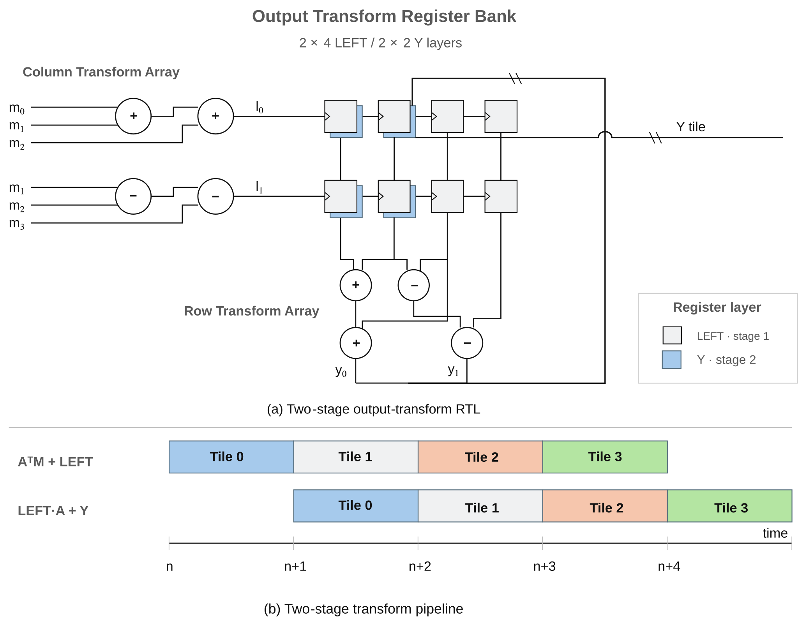

모든 입력 채널의 곱을 먼저 더한 M에 `Y = AᵀMA`를 적용한다.
4×4 M을 2×4 중간 레지스터로 줄이고 다음 단계에서 2×2 결과를 만든다.
각 덧셈·뺄셈에 INT18 포화 연산을 적용하여 정수 기준 모델의 계산 순서를 따른다.
**입력 채널마다 출력 변환을 반복하지 않고 누산 완료 후 한 번 수행한다.**

RTL: [winograd_output_transform.v](verilog/winograd_output_transform.v).


<a id="fused-output"></a>

#### 7. Tile-level operation fusion: bias·ReLU·pooling·재양자화

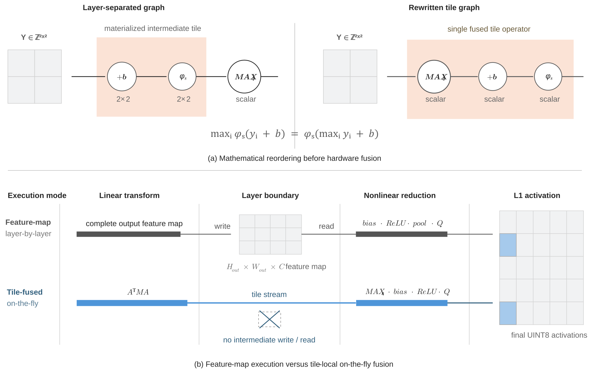

출력 변환에서 얻은 네 값에 후처리를 연속 적용하고 최종 UINT8 값만 scratchpad에 쓴다.
같은 출력 채널의 네 값에 동일한 bias와 ReLU를 적용하므로,
이 연산들의 단조성을 이용해 **max를 먼저 계산하고 bias·ReLU를 한 번만 수행**한다.
INT18 포화 bias 덧셈, ReLU, 반올림·포화를 포함한 requantization으로 정수 결과를 유지한다.
계층 사이에 네 중간값을 모두 저장하고 다시 읽는 경로를 줄이는 효과도 있다.

RTL: [winograd_postprocess.v](verilog/winograd_postprocess.v).


<a id="storage-reuse"></a>

#### 8. Lifetime-aware storage: 소비가 끝난 activation 주소 재사용

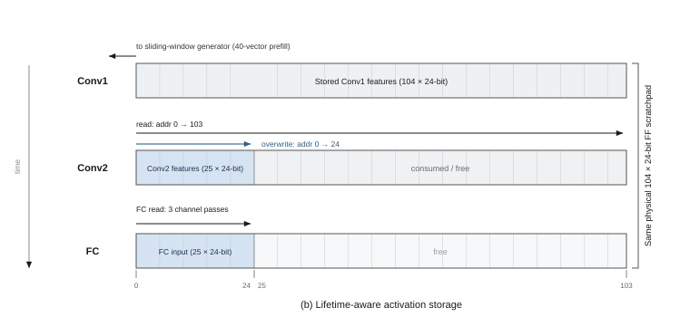

지정주제는 **104 × 24비트의 FF scratchpad 하나**를 사용한다.
Conv1 결과 중 초기 입력은 타일 생성기에 미리 공급하고, 남은 데이터는 scratchpad에 저장하여 Conv2가 순차 소비한다.
소비가 끝난 낮은 주소에는 Conv2의 25개 결과 벡터를 다시 쓰며, FC는 이를 75개 feature로 읽는다.
각 레이어의 feature map 크기를 모두 합친 저장소 대신, 데이터가 실제로 겹쳐 살아 있는 구간에 맞춰 용량을 정한다.

RTL: [저장소](verilog/winograd_sequential_frame_buffer.v),
[주소·재사용 시점 제어](verilog/winograd_cnn_accelerator.v).


<a id="icg-circuit"></a>

#### 9. ICG: 표준 셀의 latch와 클록 분기 제어

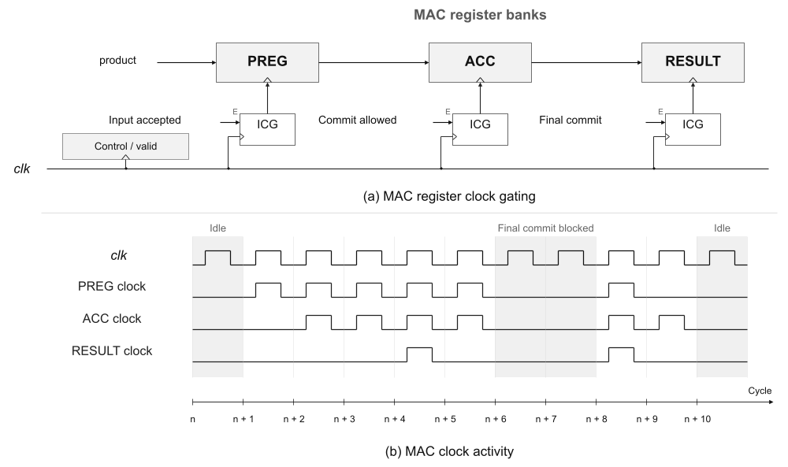

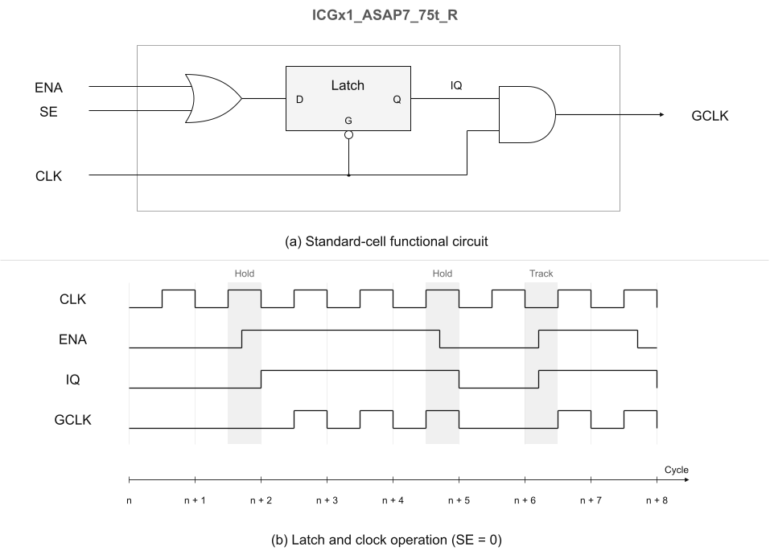

연산을 생략해도 레지스터에 클록이 계속 들어오면 클록 관련 전력은 남는다.
합성에서는 **ASAP7의 `ICGx1_ASAP7_75t_R` 셀**로 enable이 있는 레지스터 뱅크의 클록을 제어한다.
ICG의 내부 latch는 클록이 낮을 때 enable을 받고 높을 때 유지하여, enable 변화가 클록 펄스를 중간에서 자르지 않게 한다.
MAC의 PREG·ACC·RESULT는 각각 입력 수락, 누산 진행, 마지막 결과 확정 조건으로 클록을 받는다.
제어·valid 상태는 원래 클록으로 동작하며, lane 선택은 별도의 데이터·누산 제어로 처리한다.

최종 지정주제에는 ICG 셀 **16개**, 셀 면적 합계 **4.199 µm²**가 매핑되었다.
이는 최종 면적의 약 **0.054%**이며, 전체 회로의 순 면적 차이와는 구분한다.
여기서 설명하는 것은 합성된 클록 분기와 셀 동작이며, 배치배선 후 clock-tree skew 측정값을 뜻하지 않는다.

RTL: [클록 게이트 wrapper](verilog/winograd_clock_gate.v),
[MAC enable 조건](verilog/winograd_mac_array.v).
근거: [최종 합성 통계](docs/experiment_results/designated/designated_final/synth_stat.txt).


<a id="winograd-qat"></a>

#### 10. 변환 가중치와 W4A8 QAT의 연결

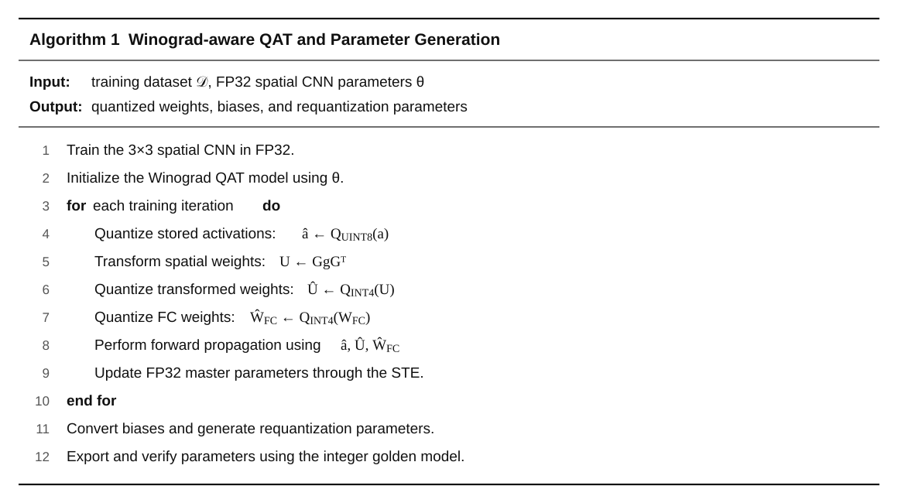

학습에서는 공간 커널을 Winograd 가중치 U로 변환한 뒤 양자화하여 추론 연산을 반영한다.
하드웨어에는 준비된 INT4 U와 FC 가중치를 전달하므로 런타임 가중치 변환기가 필요하지 않다.
Activation은 UINT8, 입력 변환과 누산은 각각 INT11·INT18로 처리하고 정수 기준 모델과 대조한다.

코드: [학습](training/train.py), [Winograd 변환](training/winograd.py),
[양자화](training/quantization.py), [정수 추론](training/integer_inference.py),
[RTL 가중치 export](training/export_model.py).


### 최종 결과

| 항목 | 결과 |
|---|---:|
| 제공 입력 분류 정확도 | 970 / 1,000, **97.0%** |
| 평가 동작 주파수 | **1 GHz** |
| 합성 후 STA 환산 Fmax | 1,162.696 MHz |
| 합성 셀 면적 | **7,769.03 µm²** |
| 평균 사이클 / 이미지 | **995.83 cycles** |
| 평균 추론 지연 @ 1 GHz | **0.99583 µs** |
| 활동도 기반 전력 | **7.868 mW** |
| 측정 구간 기준 에너지 / 이미지 | **7.888 nJ** |

ASAP7 RVT FF, 0.77 V, 0°C의 합성 후 평가이다. 사이클은 제공 입력 1,000회
(고유 이미지 100장 반복), 전력·에너지는 20개 이미지의 zero-delay gate VCD 구간에서 측정했다.
배치배선 전 STA와 활동도 기반 전력 추정값이다.

### Sparsity와 ICG의 효과 분리

동일한 공통 구조에서 두 기능만 켜고 끈 비교이다.

| 구성 | 평균 사이클 | 면적 (µm²) | 전력 (mW) | 에너지 (nJ/image) |
|---|---:|---:|---:|---:|
| 공통 구조 | 1,072.00 | 7,804.64 | 16.592 | 17.886 |
| Sparsity | 995.83 | 7,781.48 | 16.274 | 16.313 |
| ICG | 1,072.00 | 7,802.57 | 8.610 | 9.282 |
| **Sparsity + ICG** | **995.83** | **7,769.03** | **7.868** | **7.888** |

두 기능의 동시 적용으로 공통 구조 대비 사이클 **7.11%**, 에너지 **55.90%**를 줄였다.
ICG를 적용한 회로에 sparsity 처리를 추가했을 때의 에너지 감소는 **15.02%**이다.
면적의 작은 감소는 전체 합성 매핑 차이를 포함한다.

측정 원본은 [지정주제 최종 결과](docs/experiment_results/designated/designated_final/RESULTS.txt),
소스 해시와 실행 안내는 [최종본 안내](docs/experiment_results/designated/designated_final/README.txt)에 있다.

## 3. 자유주제: SRAM 기반 16코어 VGG 가속기

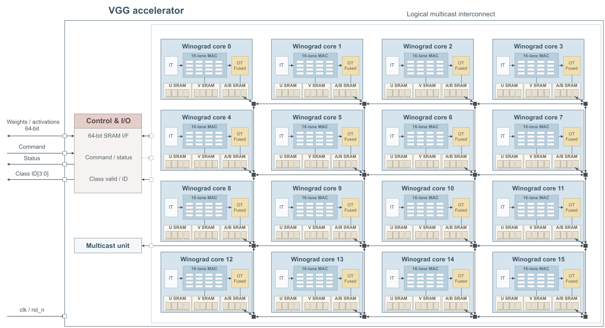

각 코어가 서로 다른 출력 채널을 담당하고, 공통 activation을 multicast로 공급한다.
변환 가중치 U와 입력 타일 V는 SRAM에 밀집 저장한다. V는 마지막 재사용까지 보존하며,
U는 물리 용량에 들어가는 범위에서 상주시켜 반복 적재를 줄인다. 큰 가중치 텐서는 묶음으로 나누어 처리한다.
FC 경로와 레이어 전환을 포함하고, 코어 내부 연산량과 SRAM 공급량을 구분하여 평가했다.

<a id="multi-core-circuits"></a>

### SRAM·멀티코어 세부 회로

<a id="sram-banks"></a>

#### 1. 코어당 12개 SRAM: U·V 저장과 activation A/B

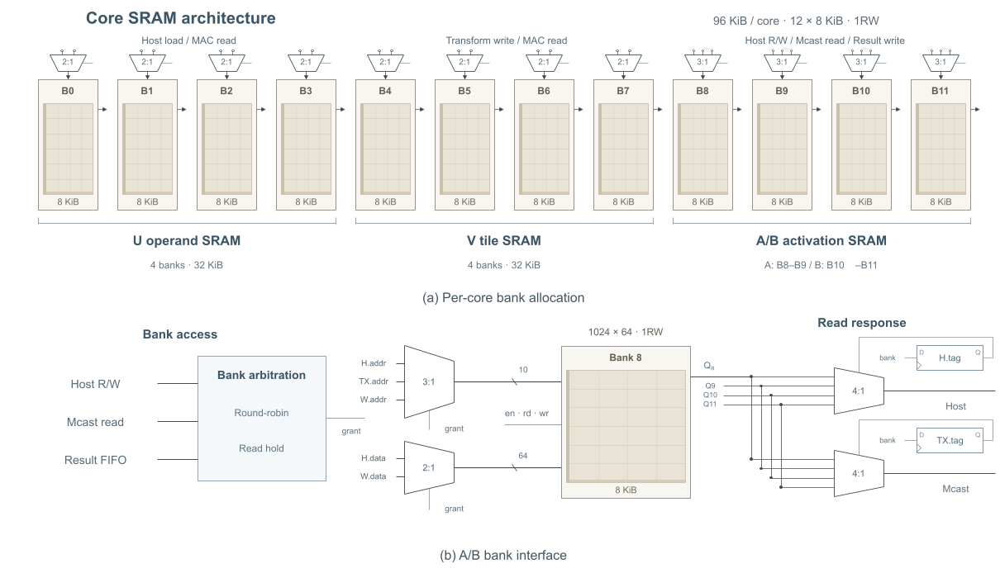

코어당 12개 macro 중 **4개는 U, 4개는 V, 나머지 4개는 activation A/B 저장**에 사용한다.
Macro 하나는 1024 × 64비트, 8KiB의 동기식 single-port 1RW SRAM이며,
RTL wrapper에서 `srambank_256x4x64_6t122`를 인스턴스화한다.
큰 배열을 FF로 펼치는 대신 SRAM 인스턴스를 유지하고 Liberty 모델로 합성·타이밍을 평가한다.

U/V scratchpad는 변환 데이터와 소유권·재사용 상태를 함께 관리한다.
Activation 저장소는 host 접근, multicast 송신용 읽기, 계산 결과 쓰기를 뱅크별로 중재한다.
서로 다른 뱅크는 병렬 접근할 수 있지만, **같은 single-port 뱅크의 접근은 중재를 거친다.**
단일 코어의 FF scratchpad를 그대로 크게 복제하는 방식과 구분되는 확장 지점이다.

RTL: [SRAM macro wrapper](free_topic_vgg/rtl/memory/vgg_sram_8k.v),
[U/V scratchpad](free_topic_vgg/rtl/memory/vgg_dataflow_scratchpad.v),
[activation 저장소·중재](free_topic_vgg/rtl/memory/vgg_activation_sram.v).
모델·Liberty·LEF와 출처: [ASAP7 SRAM 라이브러리](submission/IDEC2026_FREE_TOPIC/02_libraries/asap7_sram/).


<a id="multicast-circuit"></a>

#### 2. 출력 채널 샤딩과 공통 activation multicast

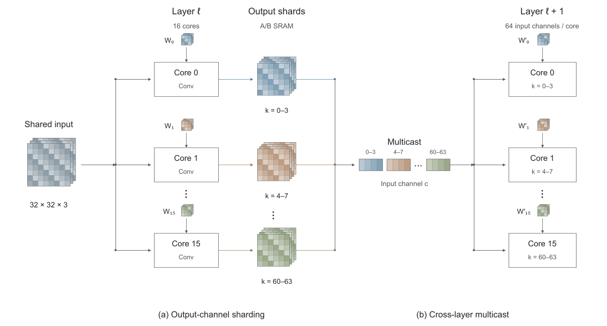

서로 다른 출력 채널을 담당하는 코어들은 각자의 U를 사용하지만 같은 입력 activation을 필요로 한다.
따라서 **공통 입력을 한 번 읽어 필요한 코어들에 분배**하고, 각 코어가 자기 출력 채널의 결과를 만든다.
다음 레이어에서는 출력 shard가 놓인 코어·주소를 따라 입력을 읽는다.

현재 주 데이터 경로는 activation A/B SRAM → 공유 activation feed → multicast·수신 버퍼 →
코어별 4×4 타일 조립 → 입력 변환 → V SRAM → 행별 MAC이다.
Feed가 타일 순서로 데이터를 공급하고 코어 안에서 변환하므로, multicast 대상은 변환된 V가 아니다.

Fanout은 payload를 수신 코어 수만큼 복제해 저장하는 대신 FIFO head와 `delivered` 비트맵을 유지한다.
이미 받은 코어의 valid를 내리고 모든 지정 코어가 수락한 뒤 다음 word로 이동하여,
수신 코어들의 정지 시점이 달라도 **각 word를 중복 없이 한 번씩 전달**한다.
이는 수신 endpoint의 수락 보장이며, MAC이 그 word의 계산을 끝냈다는 뜻은 아니다.

RTL: [16코어 연결](free_topic_vgg/rtl/vgg_sixteen_core_cluster.v),
[레이어·A/B 제어](free_topic_vgg/rtl/vgg_ab_layer_cluster.v),
[activation feed](free_topic_vgg/rtl/interconnect/vgg_activation_feed.v),
[multicast fanout](free_topic_vgg/rtl/interconnect/vgg_mcast_fanout.v),
[코어별 타일 조립](free_topic_vgg/rtl/core/vgg_tile_stream_reader.v).


<a id="sram-compute"></a>

#### 3. SRAM 이후의 계산: V 재사용, 행 선택, 결과 저장

V를 SRAM에 저장한 뒤 출력 채널을 바꾸어 다시 읽고,
행별 zero mask로 유효 작업을 선택하여 MAC에 투입한다.
U/V의 저장 스케일은 연산 경로에서 복원하고, 입력 채널 누산이 끝나면 출력 변환과 후처리를 수행한다.
결과 쓰기 경로는 다음 레이어가 읽을 activation 저장소로 이어진다.
Convolution과 FC는 모드에 맞는 입력·가중치 공급 및 누산 제어를 사용한다.

RTL: [코어 데이터 흐름](free_topic_vgg/rtl/core/vgg_dataflow_core.v),
[V8 양자화](free_topic_vgg/rtl/core/vgg_v8_quantizer.v),
[행별 MAC 엔진](free_topic_vgg/rtl/core/vgg_row_mac_engine.v),
[출력 변환·후처리](free_topic_vgg/rtl/core/vgg_result_pipeline.v),
[FC 엔진](free_topic_vgg/rtl/core/vgg_fc_engine.v).

아래 통제 실험은 이 계산 경로의 공급 조건을 바꾸어, MAC 투입량 감소가
사이클·에너지 감소로 이어지는 정도를 비교한다.


### 전체 합성과 기능 검증

| 항목 | 결과 |
|---|---:|
| 계산 코어 / SRAM macro | **16 / 192** |
| SRAM 포함 Liberty 셀 면적 | **742,748.20 µm²** |
| 합성 후 STA 최소 주기 | **1,377.62 ps** |
| STA 환산 Fmax | **725.89 MHz** |
| U8/V8 소프트웨어 정확도 | CIFAR-10 10,000장, **93.94%** |

전체 모델 RTL 통과 기록은 **U8/V16 이미지 1장**이다. 최종 U8/V8은 부분 계층,
Conv/FC 연결 및 모드 전환 검증을 수행했다. 소프트웨어 정확도와 전체 모델 RTL 검증은 구분한다.
[전체 합성·통합 검증 자료](submission/IDEC2026_FREE_TOPIC/01_project/evidence/timing_writer_pipeline/)에서
원본 리포트와 넷리스트를 확인할 수 있다.

### 공급 속도와 sparsity에 따른 효과


통제 실험은 입력 **[1, 4, 4, 32]**, 출력 채널 **8개**, U 상주 조건에서
변환 후 zero-row 비율 0·25·50·75·100%와 공급 간격 1·4·8 cycles/word를 조합했다.
각 조건의 sparsity OFF/ON을 비교한 **30회 게이트 시뮬레이션**으로 사이클과 에너지를 측정했다.

| Zero-row 50% 조건 | 사이클 감소 | 에너지 감소 |
|---|---:|---:|
| 1 word / cycle | **39.28%** | **41.64%** |
| 1 word / 4 cycles | 17.73% | 21.99% |
| 1 word / 8 cycles | 4.89% | 8.92% |

공급이 충분할수록 MAC 작업 생략이 실행 시간 감소로 이어진다. 공급 대기가 길어지면
생략한 연산만큼 전체 사이클이 줄어들지는 않는다. 별표는 실제 CIFAR-10 이미지의
Conv8·Conv9·Conv12·Conv13 레이어 슬라이스이며, 통제 곡선과 텐서 크기가 다른 응용 예시이다.

이 전력 비교는 **계산 코어와 내부 U/V SRAM 8개**를 대상으로 하며, ICG는 양쪽 모두 유지했다.
클록은 1,430 ps(약 699.3 MHz), 측정 구간은 초기 적재 이후 명령 시작부터 완료까지이다.
전체 16코어와 외부 activation SRAM·multicast를 포함한 전력값은 아니다.
Sparsity 제어의 순 면적 증가는 SRAM 포함 **0.576%**, 로직만 비교하면 **1.221%**이다.


별도의 전체 convolution 계층 집계에서는 direct 연산량 313.20M MACs에 대해
Winograd 139.20M, sparsity-aware Winograd 96.38M MAC 투입을 기록했다.
이는 연산 투입량 비교이며 전력·사이클 감소율과는 구분한다.
향후 과제는 SRAM 접근, multicast 통신, 외부 가중치 공급을 계산과 더 효율적으로 겹쳐
데이터 공급 병목을 낮추는 것이다.

## 4. 재현

### 지정주제

최종 RTL은 `verilog/chip.v`를 top으로 사용한다.
Vivado 2024.1 프로젝트와 제출 산출물은 [submission/IDEC2026/](submission/IDEC2026/)에 있다.

```sh
make verify-designated-final
```

합성은 `flow/openroad/run_designated_final.sh`, 비교 실험은
`scripts/report_data/`와 [지정주제 최종본 안내](docs/experiment_results/designated/designated_final/README.txt)를 따른다.

### 자유주제 PPA

Linux/WSL에서 Icarus Verilog, Yosys, OpenROAD/ORFS를 사용한다.
필요한 SRAM Verilog·Liberty·LEF, 게이트 모델, 벡터와 기존 결과를 제출 폴더에 포함했다.
툴 버전은 [TOOL_VERSIONS.txt](submission/IDEC2026_FREE_TOPIC/TOOL_VERSIONS.txt)를 따른다.

```sh
cd submission/IDEC2026_FREE_TOPIC
export ORFS_ROOT=/path/to/OpenROAD-flow-scripts
python3 run.py check
python3 run.py controlled    # 30조건 통제 실험
python3 run.py vgg           # Conv9·Conv13 OFF/ON
python3 run.py examples      # Conv8·Conv12 OFF/ON
python3 run.py area          # 면적 비교
# python3 run.py synth       # 전체 재합성: 별도 장시간 작업
```

Icarus 게이트 시뮬레이션으로 VCD를 생성하고 OpenROAD로 전력·타이밍을 분석한다.
새 결과는 각 평가 폴더의 `reproduced_results/`에 저장한다.
개발용 Verilator 흐름은 [free_topic_vgg/README.txt](free_topic_vgg/README.txt)에 정리했다.

## 5. 저장소 안내

| 경로 | 내용 |
|---|---|
| `verilog/`, `verification/`, `training/`, `flow/` | 지정주제 RTL·검증·학습·합성 |
| `free_topic_vgg/` | 자유주제 RTL·모델 도구·검증 |
| `docs/` | 최종 보고서 |
| `docs/figures/graphs/` | 실험 그래프 |
| `docs/figures/architecture/` | 아키텍처·회로 그림 |
| `docs/experiment_results/` | 지정주제·자유주제 실험결과 |
| `submission/IDEC2026/` | 지정주제 제출 산출물 |
| `submission/IDEC2026_FREE_TOPIC/` | 자유주제 최종 소스·라이브러리·PPA 재현 패키지 |
| `scripts/validate_free_topic_package.py` | 제출 파일·해시 검증 및 ZIP 생성 |
| `scripts/audit_extended_ppa.py` | 실험 결과·에너지 계산·ZIP 일치 검사 |

최종 문서 위치는 [자료 안내](docs/FINAL_DELIVERY.md)에 정리했다.
제출 ZIP과 생성 캐시는 Git에서 제외하며, 저장소에는 압축 전 원본과 재현 근거를 유지한다.

ASAP7 SRAM 및 외부 모델의 라이선스·출처는
[SRAM 라이브러리](submission/IDEC2026_FREE_TOPIC/02_libraries/asap7_sram/)와
[모델 원본 자료](submission/IDEC2026_FREE_TOPIC/01_project/reference/upstream/)에 포함되어 있다.

## 개발 지원

**AI-assisted development:** OpenAI Codex — RTL 구현·검토, 검증 자동화, 실험 분석 및 문서 작성 지원.
