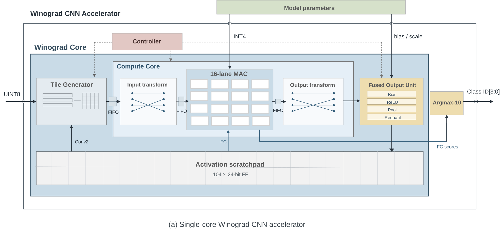
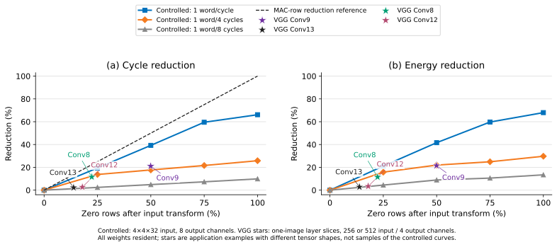
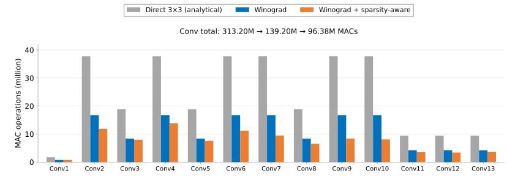

# Sparsity-Aware Winograd CNN Accelerators

2026 IDEC 창의회로설계 챌린지 디지털 부문 **SKKAF**팀의 지정주제·자유주제 설계와 검증 자료이다.
Winograd, 변환 영역의 zero-row 생략, integrated clock gating(ICG)을 결합하고,
MNIST 단일 코어에서 검증한 방법을 CIFAR-10 VGG의 SRAM 기반 16코어 구조로 확장하였다.

| | 지정주제 | 자유주제 |
|---|---|---|
| 응용 | MNIST 이미지 분류 | CIFAR-10 VGG 이미지 분류 |
| 구조 | Conv/FC 공유 단일 코어 | 출력 채널을 분담하는 16코어, activation multicast |
| 연산 자원 | 16-lane MAC | 코어당 16-lane MAC |
| 수치 형식 | W4A8, 변환 V INT11, 누산 INT18 | 변환 U/V INT8 저장, 스케일 복원 후 연산 |
| 저장 구조 | activation scratchpad와 소형 pipeline buffer | 코어당 12개 × 8KiB SRAM, 총 192개 macro |
| 최종 RTL | [verilog/](verilog/) | [free_topic_vgg/rtl/](free_topic_vgg/rtl/) |
| 결과보고서 | [지정주제 PDF](docs/IDEC_지정주제_결과보고서_제출용.pdf) | [자유주제 PDF](docs/IDEC_자유주제_결과보고서_제출용.pdf) |

## 1. 공통 설계 방법

Winograd F(2×2, 3×3)는 4×4 입력 타일로부터 2×2 출력을 생성한다.
동일한 네 출력을 만드는 direct 3×3 convolution의 36회 곱셈을 16회로 줄이며,
입력·출력 변환은 덧셈과 뺄셈으로 구현한다.

```text
U = G g Gᵀ              변환 가중치
V = Bᵀ d B              변환 activation
M = Σc (U ⊙ V)          입력 채널 방향 누산
Y = Aᵀ M A              출력 변환
```

변환 과정에서 검출한 zero row는 MAC에 투입하지 않고 유효 행만 처리하도록 순서를 제어한다.
ICG는 유효 작업이 없는 레지스터의 클록 활동을 억제한다. 생성된 결과에는 bias, ReLU,
pooling 및 requantization을 연속 적용하여 중간 데이터 이동을 줄인다.
두 주제는 이 최적화 방법을 공유하며, 저장 장치와 데이터 공급 구조는 모델의 규모에 맞춰 구성했다.

## 2. 지정주제: 단일 코어 MNIST 가속기



3×3 convolution 두 계층과 FC를 하나의 연산기로 처리한다. W4A8 QAT와 정수 기준 모델로
수치 형식을 결정하고, activation의 소비 시점에 따라 scratchpad 주소를 재사용한다.
최종 구성은 sparsity-aware bypass와 ICG를 함께 적용한 **b1_g1**이다.

### 최종 결과

| 항목 | 결과 |
|---|---:|
| 제공 입력 분류 정확도 | 970 / 1,000, **97.0%** |
| 평가 동작 주파수 | **1 GHz** |
| 합성 후 STA 환산 Fmax | 1,162.696 MHz |
| 합성 셀 면적 | **7,769.03 µm²** |
| 평균 사이클 / 이미지 | **995.83 cycles** |
| 평균 추론 지연 @ 1 GHz | **0.99583 µs** |
| 활동도 기반 전력 | **7.868 mW** |
| 측정 구간 기준 에너지 / 이미지 | **7.888 nJ** |

ASAP7 RVT FF, 0.77 V, 0°C의 합성 후 평가이다. 사이클은 제공 입력 1,000회
(고유 이미지 100장 반복), 전력·에너지는 20개 이미지의 zero-delay gate VCD 구간에서 측정했다.
배치배선 전 STA와 활동도 기반 전력 추정값이다.

### Sparsity와 ICG의 효과 분리

동일한 공통 구조에서 두 기능만 켜고 끈 비교이다.

| 구성 | 평균 사이클 | 면적 (µm²) | 전력 (mW) | 에너지 (nJ/image) |
|---|---:|---:|---:|---:|
| 공통 구조 | 1,072.00 | 7,804.64 | 16.592 | 17.886 |
| Sparsity | 995.83 | 7,781.48 | 16.274 | 16.313 |
| ICG | 1,072.00 | 7,802.57 | 8.610 | 9.282 |
| **Sparsity + ICG** | **995.83** | **7,769.03** | **7.868** | **7.888** |

두 기능의 동시 적용으로 공통 구조 대비 사이클 **7.11%**, 에너지 **55.90%**를 줄였다.
ICG를 적용한 회로에 sparsity 처리를 추가했을 때의 에너지 감소는 **15.02%**이다.
면적의 작은 감소는 전체 합성 매핑 차이를 포함한다.

측정 원본은 [지정주제 최종 결과](docs/designated_final/RESULTS.txt),
소스 해시와 실행 안내는 [최종본 안내](docs/designated_final/README.txt)에 있다.

## 3. 자유주제: SRAM 기반 16코어 VGG 가속기


각 코어가 서로 다른 출력 채널을 담당하고, 공통 activation을 multicast로 공급한다.
변환 가중치 U와 입력 타일 V는 SRAM에 밀집 저장한다. V는 마지막 재사용까지 보존하며,
U는 물리 용량에 들어가는 범위에서 상주시켜 반복 적재를 줄인다. 큰 가중치 텐서는 묶음으로 나누어 처리한다.
FC 경로와 레이어 전환을 포함하고, 코어 내부 연산량과 SRAM 공급량을 구분하여 평가했다.

### 전체 합성과 기능 검증

| 항목 | 결과 |
|---|---:|
| 계산 코어 / SRAM macro | **16 / 192** |
| SRAM 포함 Liberty 셀 면적 | **742,748.20 µm²** |
| 합성 후 STA 최소 주기 | **1,377.62 ps** |
| STA 환산 Fmax | **725.89 MHz** |
| U8/V8 소프트웨어 정확도 | CIFAR-10 10,000장, **93.94%** |

전체 모델 RTL 통과 기록은 **U8/V16 이미지 1장**이다. 최종 U8/V8은 부분 계층,
Conv/FC 연결 및 모드 전환 검증을 수행했다. 소프트웨어 정확도와 전체 모델 RTL 검증은 구분한다.
[전체 합성·통합 검증 자료](submission/IDEC2026_FREE_TOPIC/01_project/evidence/timing_writer_pipeline/)에서
원본 리포트와 넷리스트를 확인할 수 있다.

### 공급 속도와 sparsity에 따른 효과



통제 실험은 입력 **[1, 4, 4, 32]**, 출력 채널 **8개**, U 상주 조건에서
변환 후 zero-row 비율 0·25·50·75·100%와 공급 간격 1·4·8 cycles/word를 조합했다.
각 조건의 sparsity OFF/ON을 비교한 **30회 게이트 시뮬레이션**으로 사이클과 에너지를 측정했다.

| Zero-row 50% 조건 | 사이클 감소 | 에너지 감소 |
|---|---:|---:|
| 1 word / cycle | **39.28%** | **41.64%** |
| 1 word / 4 cycles | 17.73% | 21.99% |
| 1 word / 8 cycles | 4.89% | 8.92% |

공급이 충분할수록 MAC 작업 생략이 실행 시간 감소로 이어진다. 공급 대기가 길어지면
생략한 연산만큼 전체 사이클이 줄어들지는 않는다. 별표는 실제 CIFAR-10 이미지의
Conv8·Conv9·Conv12·Conv13 레이어 슬라이스이며, 통제 곡선과 텐서 크기가 다른 응용 예시이다.

이 전력 비교는 **계산 코어와 내부 U/V SRAM 8개**를 대상으로 하며, ICG는 양쪽 모두 유지했다.
클록은 1,430 ps(약 699.3 MHz), 측정 구간은 초기 적재 이후 명령 시작부터 완료까지이다.
전체 16코어와 외부 activation SRAM·multicast를 포함한 전력값은 아니다.
Sparsity 제어의 순 면적 증가는 SRAM 포함 **0.576%**, 로직만 비교하면 **1.221%**이다.



별도의 전체 convolution 계층 집계에서는 direct 연산량 313.20M MACs에 대해
Winograd 139.20M, sparsity-aware Winograd 96.38M MAC 투입을 기록했다.
이는 연산 투입량 비교이며 전력·사이클 감소율과는 구분한다.
향후 과제는 SRAM 접근, multicast 통신, 외부 가중치 공급을 계산과 더 효율적으로 겹쳐
데이터 공급 병목을 낮추는 것이다.

## 4. 재현

### 지정주제

최종 RTL은 `verilog/chip.v`를 top으로 사용한다.
Vivado 2024.1 프로젝트와 제출 산출물은 [submission/IDEC2026/](submission/IDEC2026/)에 있다.

```sh
make verify-designated-final
```

합성은 `flow/openroad/run_designated_final.sh`, 비교 실험은
`scripts/report_data/`와 [지정주제 최종본 안내](docs/designated_final/README.txt)를 따른다.

### 자유주제 PPA

Linux/WSL에서 Icarus Verilog, Yosys, OpenROAD/ORFS를 사용한다.
필요한 SRAM Verilog·Liberty·LEF, 게이트 모델, 벡터와 기존 결과를 제출 폴더에 포함했다.
툴 버전은 [TOOL_VERSIONS.txt](submission/IDEC2026_FREE_TOPIC/TOOL_VERSIONS.txt)를 따른다.

```sh
cd submission/IDEC2026_FREE_TOPIC
export ORFS_ROOT=/path/to/OpenROAD-flow-scripts
python3 run.py check
python3 run.py controlled    # 30조건 통제 실험
python3 run.py vgg           # Conv9·Conv13 OFF/ON
python3 run.py examples      # Conv8·Conv12 OFF/ON
python3 run.py area          # 면적 비교
# python3 run.py synth       # 전체 재합성: 별도 장시간 작업
```

Icarus 게이트 시뮬레이션으로 VCD를 생성하고 OpenROAD로 전력·타이밍을 분석한다.
새 결과는 각 평가 폴더의 `reproduced_results/`에 저장한다.
개발용 Verilator 흐름은 [free_topic_vgg/README.txt](free_topic_vgg/README.txt)에 정리했다.

## 5. 저장소 안내

| 경로 | 내용 |
|---|---|
| `verilog/`, `verification/`, `training/`, `flow/` | 지정주제 RTL·검증·학습·합성 |
| `free_topic_vgg/` | 자유주제 RTL·모델 도구·검증 |
| `docs/` | 최종 보고서, 그림, 수치 근거 |
| `submission/IDEC2026/` | 지정주제 제출 산출물 |
| `submission/IDEC2026_FREE_TOPIC/` | 자유주제 최종 소스·라이브러리·PPA 재현 패키지 |
| `scripts/validate_free_topic_package.py` | 제출 파일·해시 검증 및 ZIP 생성 |
| `scripts/audit_extended_ppa.py` | 실험 결과·에너지 계산·ZIP 일치 검사 |

최종 문서 위치는 [자료 안내](docs/FINAL_DELIVERY.md)에 정리했다.
제출 ZIP과 생성 캐시는 Git에서 제외하며, 저장소에는 압축 전 원본과 재현 근거를 유지한다.

ASAP7 SRAM 및 외부 모델의 라이선스·출처는
[SRAM 라이브러리](submission/IDEC2026_FREE_TOPIC/02_libraries/asap7_sram/)와
[모델 원본 자료](submission/IDEC2026_FREE_TOPIC/01_project/reference/upstream/)에 포함되어 있다.
